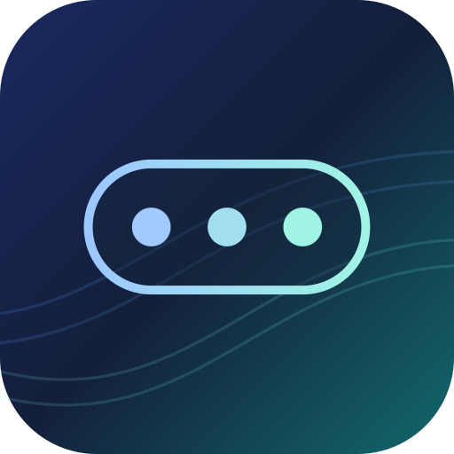

# GalaxyApps

### GalaxyBar · GalaxySplit

Приложения для ГУ **Geely Galaxy Starship 7 (дорестайлинг)**.

Разрабатывались и тестировались на дорестайлинговой версии автомобиля.

[Релизы и обсуждение в Telegram](https://t.me/GalaxyAppsRU) · [Связаться с автором](https://t.me/Den_Topchiev)

<table>
<tr>
<td align="center" width="50%">

<h2>GalaxyBar</h2>

Ярлыки, папки и данные автомобиля в верхней строке ГУ.

<a href="galaxybar/README.md"><strong>О приложении</strong></a> · <a href="https://backer13.github.io/GalaxyApps-updates/galaxybar/">Интерактивный макет</a>

</td>
<td align="center" width="50%">

<h2>GalaxySplit</h2>

Два или три приложения на одном экране. Сохранённые пресеты и удобное управление.

<a href="galaxysplit/README.md"><strong>О приложении</strong></a> · <a href="https://backer13.github.io/GalaxyApps-updates/galaxysplit/">Интерактивный макет</a>

</td>
</tr>
</table>

## Попробовать интерфейс

Интерактивные макеты открываются в браузере: можно переключать разделы, открывать окна и пробовать настройки. Показания автомобиля в макетах тестовые.

- **[Открыть GalaxyBar](https://backer13.github.io/GalaxyApps-updates/galaxybar/)**
- **[Открыть GalaxySplit](https://backer13.github.io/GalaxyApps-updates/galaxysplit/)**

Макеты могут показывать функции, которые ещё готовятся к выпуску.

## Тест GalaxySplit для EX5 EM-i

[Открыть веб-установщик](https://backer13.github.io/GalaxyApps-updates/galaxysplit-ex5/) — предварительная сборка EX5 0.02 для Android 11 с основным интерфейсом GalaxySplit: пресеты, разовый запуск, островок, быстрая замена, изменение размеров и резервные копии. Три окна — экспериментальный режим. На странице доступны APK, USB-подключение из браузера, локальные мосты для Windows и Android и диагностика. Разрешение для островка выдаётся через ADB. Предыдущий тест двух окон 0.01 подтверждён владельцем EX5 EM-i; версия 0.02 требует проверки на ГУ. Камеры и управление системными панелями пока недоступны.

## APK и новые версии

Публичные релизы, APK и основные изменения публикуются в **[Telegram — @GalaxyAppsRU](https://t.me/GalaxyAppsRU)**. Приложения также можно найти в SnickPro Store.

Оба приложения бесплатные. Пожертвования добровольные и не влияют на доступ к функциям. Идеи и обратная связь приветствуются.

Поддержать автора — QR-код

Пожертвования полностью добровольные. Спасибо за поддержку развития GalaxyBar и GalaxySplit!

---

Сведения о версиях для приложений

В этом репозитории находится [versions.json](versions.json) — публичные данные для проверки обновлений. Исходники Android хранятся отдельно, в закрытом репозитории. Публичное размещение APK разрешено автором; тестовые сборки не объявляются в ленте обновлений.

В файл попадают только опубликованные релизы. Промежуточные сборки не объявляются пользователям как обновления.

Описание формата — [version-feed.md](docs/version-feed.md).

