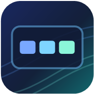

# GalaxyBar

### Всё нужное — в верхней строке

Ярлыки приложений, папки, автомобильные виджеты и быстрые действия.

**[Попробовать интерактивный макет](https://backer13.github.io/GalaxyApps-updates/galaxybar/)** · **[APK и релизы](https://t.me/GalaxyAppsRU)**

## Панель под себя

- Закреплённые и последние приложения, папки со списком или плитками.
- Ярлыки пресетов GalaxySplit для запуска двух приложений одним нажатием.
- Порядок и видимость элементов, размеры и оформление значков.
- Цветной, монохромный, контурный вид и оттенки серого.

## Данные автомобиля

Виджеты батареи и ДВС показывают основные значения прямо в строке. По нажатию открывается расширенная информация.

- Заряд и температура тяговой батареи, прогноз EV по накопленной статистике.
- Обороты и температура ДВС, уровень топлива и прогноз запаса хода.
- Настройки шрифта, размера цифр, единиц измерения, фона и заливки.

Также доступны виджет температуры и влажности салона, мощность тяговой батареи в кВт и напряжение АКБ 12 В. В разделе «Сервисные данные» показания собраны по группам; прогнозы EV и ДВС можно сравнить со штатными.

## Быстрые действия

Диспетчер задач, управление подогревом, вентиляцией и массажем сидений, обогрев заднего стекла и зеркал. Настройки и статистику прогнозов можно сохранить в резервную копию.

## Ночной режим

Приглушённый экран со скоростью, оборотами ДВС или мощностью тяговой батареи, музыкой и основными данными автомобиля. Яркость и состав показателей настраиваются. Для выхода удерживайте экран 1 секунду.

## Посмотреть перед установкой

**[Открыть GalaxyBar в браузере →](https://backer13.github.io/GalaxyApps-updates/galaxybar/)**

В макете можно попробовать настройки, папки и виджеты. Значения тестовые; часть функций может относиться к будущему релизу.

## Получить приложение

**[Релизы и обсуждение • Telegram • @GalaxyAppsRU](https://t.me/GalaxyAppsRU)**

Приложение также доступно в SnickPro Store. GalaxyBar бесплатный, поддержка автора добровольная.

---

[Все приложения](../README.md) · [GalaxySplit](../galaxysplit/README.md) · [Автор • @Den_Topchiev](https://t.me/Den_Topchiev)
