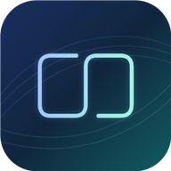

# GalaxySplit

### Два или три приложения на одном экране

Навигация и музыка, карта и камера — удобные сочетания с запуском из пресета.

**[Попробовать интерактивный макет](https://backer13.github.io/GalaxyApps-updates/galaxysplit/)** · **[Скачать GalaxySplit 1.54 в Telegram](https://t.me/GalaxyAppsRU/570)**

## Сохранить и запустить

Выберите два или три приложения, настройте расположение и сохраните пресет. После этого нужное сочетание запускается одним нажатием.

- Сохранённые сочетания приложений и пропорции разделения экрана.
- Несколько пресетов для разных сценариев.
- Ярлыки пресетов в верхней строке GalaxyBar.

## Управление рядом

Компактный островок располагается у стыка приложений. Настройки позволяют выбрать его вид и поведение, а также настроить верхнюю системную панель.

## Удобно каждый день

- Светлая, тёмная и автоматическая тема.
- Масштаб интерфейса под свои предпочтения.
- Настройки запуска и фоновой работы.
- Резервные копии настроек и пресетов.

## Посмотреть перед установкой

**[Открыть GalaxySplit в браузере →](https://backer13.github.io/GalaxyApps-updates/galaxysplit/)**

Интерактивный макет позволяет попробовать интерфейс и настройки без установки на ГУ. Поведение приложений в нём демонстрационное.

## Получить приложение

**[Релизы и обсуждение • Telegram • @GalaxyAppsRU](https://t.me/GalaxyAppsRU)**

Приложение также доступно в SnickPro Store. GalaxySplit бесплатный, поддержка автора добровольная.

---

[Все приложения](../README.md) · [GalaxyBar](../galaxybar/README.md) · [Автор • @Den_Topchiev](https://t.me/Den_Topchiev)
